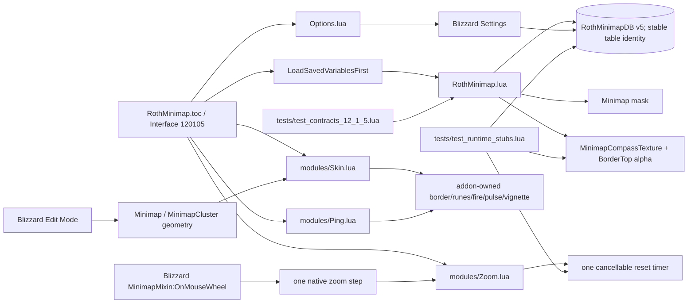

# Roth Minimap code graph

Clock, calendar, tracking, difficulty, mail, housing/landing-page controls, queues, Addon Compartment, and native/third-party minimap buttons have no ownership edge from Roth Minimap.
