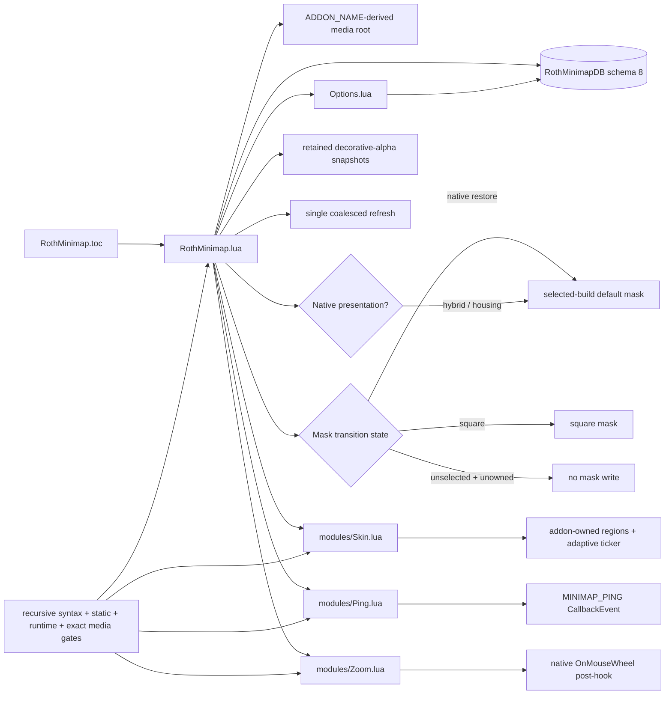

# Roth Minimap code graph — 0.4.6

No edge grants ownership of `MinimapCluster`, `MinimapBackdrop`, Hybrid Minimap, MapCanvas masks, housing overlays, third-party buttons, or an arbitrary foreign mask.
